<picture>
  <source media="(prefers-color-scheme: dark)" srcset="../resources/logos/claude-howto-logo-dark.svg">
  
</picture>

# Hướng Dẫn Đầy Đủ Về Các Khái Niệm Của Claude

Tổng quan khái niệm về cách các tính năng của Claude Code hoạt động và kết hợp với nhau: sơ đồ kiến trúc, bảng ra quyết định và so sánh giữa Lệnh Slash, Tác Nhân Con, Bộ Nhớ, MCP, Skills, Plugins, Hooks và nhiều hơn nữa.

> **Cách dùng hướng dẫn này**: trang này giải thích các *khái niệm*, tức là mỗi tính năng là gì, hoạt động bên trong ra sao và khi nào nên dùng. **Các template copy-paste và tài liệu tham khảo đầy đủ nằm trong các module đánh số** (`01-` đến `10-`), được liên kết từ từng phần. Hãy bắt đầu ở đây để xây dựng mô hình tư duy, sau đó chuyển sang module tương ứng để thực sự cấu hình.

---

## Mục Lục

1. [Lệnh Slash](#lệnh-slash) ([module](01-slash-commands/))
2. [Tác Nhân Con](#tác-nhân-con) ([module](04-subagents/))
3. [Bộ Nhớ](#bộ-nhớ) ([module](02-memory/))
4. [Giao Thức MCP](#giao-thức-mcp) ([module](05-mcp/))
5. [Agent Skills](#agent-skills) ([module](03-skills/))
6. [Plugins](#plugins-của-claude-code) ([module](07-plugins/))
7. [So Sánh & Tích Hợp](#so-sánh--tích-hợp)
8. [Bảng Tóm Tắt](#bảng-tóm-tắt)
9. [Hướng Dẫn Bắt Đầu Nhanh](#hướng-dẫn-bắt-đầu-nhanh)
10. [Hooks](#hooks) ([module](06-hooks/))
11. [Checkpoints và Rewind](#checkpoints-và-rewind) ([module](08-checkpoints/))
12. [Tính Năng Nâng Cao](#tính-năng-nâng-cao) ([module](09-advanced-features/))
13. [Mô Hình và Mức Độ Suy Luận](#mô-hình-và-mức-độ-suy-luận) ([module](10-cli/))
14. [Tài Nguyên](#tài-nguyên)

---

## Lệnh Slash

### Tổng Quan

Lệnh slash là các lối tắt do người dùng gọi, được lưu dưới dạng file Markdown mà Claude Code có thể thực thi. Chúng giúp các đội chuẩn hóa những prompt và workflow thường dùng.

### Kiến Trúc

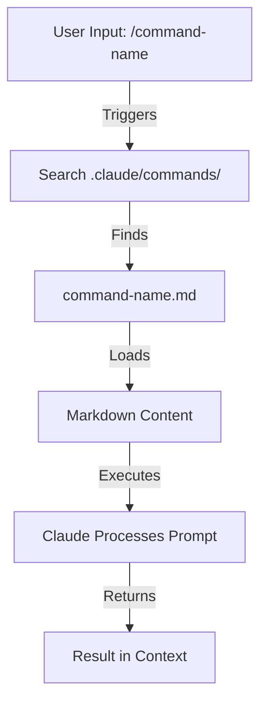

### Cấu Trúc File

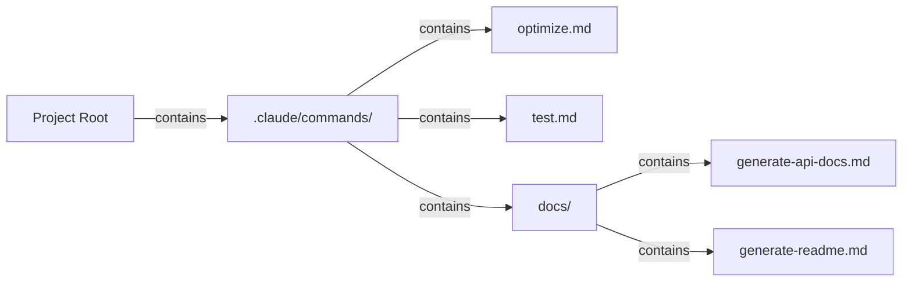

### Bảng Tổ Chức Lệnh

| Vị Trí | Phạm Vi | Khả Dụng Cho | Trường Hợp Sử Dụng | Theo Dõi Bằng Git |
|----------|-------|--------------|----------|-------------|
| `.claude/commands/` | Riêng cho dự án | Thành viên trong đội | Workflow của đội, tiêu chuẩn chung | ✅ Có |
| `~/.claude/commands/` | Cá nhân | Người dùng cá nhân | Lối tắt cá nhân dùng cho mọi dự án | ❌ Không |
| Thư mục con | Có namespace | Theo thư mục cha | Tổ chức theo danh mục | ✅ Có |

### Tính Năng & Khả Năng

| Tính Năng | Ví Dụ | Hỗ Trợ |
|---------|---------|-----------|
| Thực thi shell script | `bash scripts/deploy.sh` | ✅ Có |
| Tham chiếu file | `@path/to/file.js` | ✅ Có |
| Tích hợp Bash | `$(git log --oneline)` | ✅ Có |
| Tham số | `/pr --verbose` | ✅ Có |
| Lệnh MCP | `/mcp__github__list_prs` | ✅ Có |

### Ví Dụ Thực Tế

Tám template lệnh copy-paste nằm trong **[01-slash-commands/](01-slash-commands/)**: `/optimize`, `/pr`, `/commit`, `/push-all`, `/generate-api-docs`, `/doc-refactor`, `/setup-ci-cd` và `/unit-test-expand`.

**[01-slash-commands/README.md](01-slash-commands/README.md)** cũng chứa tài liệu tham khảo đầy đủ về các lệnh tích hợp sẵn (hơn 60 lệnh) và bảng các trường frontmatter.

### Sơ Đồ Vòng Đời Lệnh

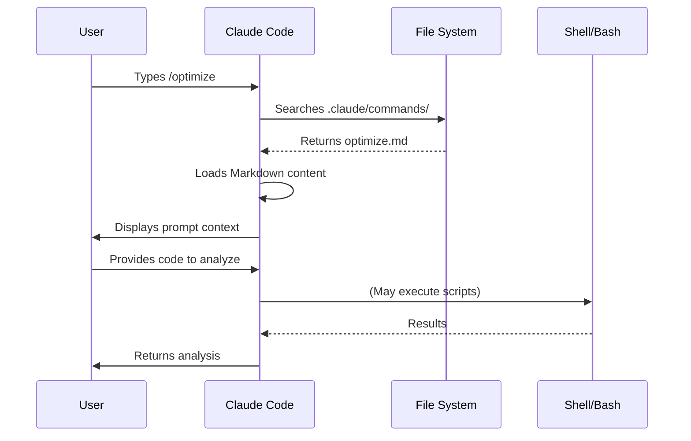

### Thực Hành Tốt Nhất

| ✅ Nên | ❌ Không Nên |
|------|---------|
| Dùng tên rõ ràng, hướng hành động | Tạo lệnh cho tác vụ chỉ làm một lần |
| Ghi rõ từ kích hoạt trong phần mô tả | Xây dựng logic phức tạp trong lệnh |
| Giữ mỗi lệnh tập trung vào một tác vụ | Tạo các lệnh trùng lặp |
| Quản lý phiên bản các lệnh của dự án | Hardcode thông tin nhạy cảm |
| Tổ chức trong các thư mục con | Tạo danh sách lệnh quá dài |
| Dùng prompt đơn giản, dễ đọc | Dùng cách diễn đạt viết tắt hoặc khó hiểu |

---

## Tác Nhân Con

### Tổng Quan

Tác nhân con là các trợ lý AI chuyên biệt với cửa sổ ngữ cảnh tách biệt và system prompt tùy chỉnh. Chúng cho phép ủy quyền thực thi tác vụ trong khi vẫn giữ sự phân tách rõ ràng giữa các mối quan tâm.

Tác nhân con có thể tự tạo tác nhân con của riêng chúng, **lồng nhau được bật mặc định với độ sâu tối đa 3 (v2.1.219)**, vì vậy hệ phân cấp không bị giới hạn ở một lớp chính → tác nhân con như sơ đồ bên dưới. Đặt `CLAUDE_CODE_MAX_SUBAGENT_SPAWN_DEPTH` để thay đổi giới hạn, hoặc đặt `1` để tắt lồng nhau. (Lịch sử: từ v2.1.172 đến v2.1.216 lồng nhau mặc định tới 5 lớp và không thể thay đổi; v2.1.217 chuyển lồng nhau thành tùy chọn bật thủ công với độ sâu 1; v2.1.219 đặt mặc định là 3.)

### Sơ Đồ Kiến Trúc

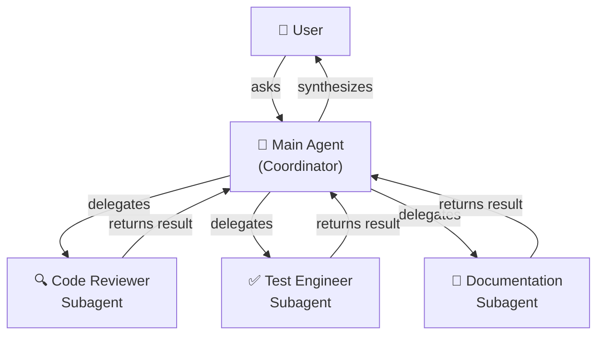

### Vòng Đời Tác Nhân Con

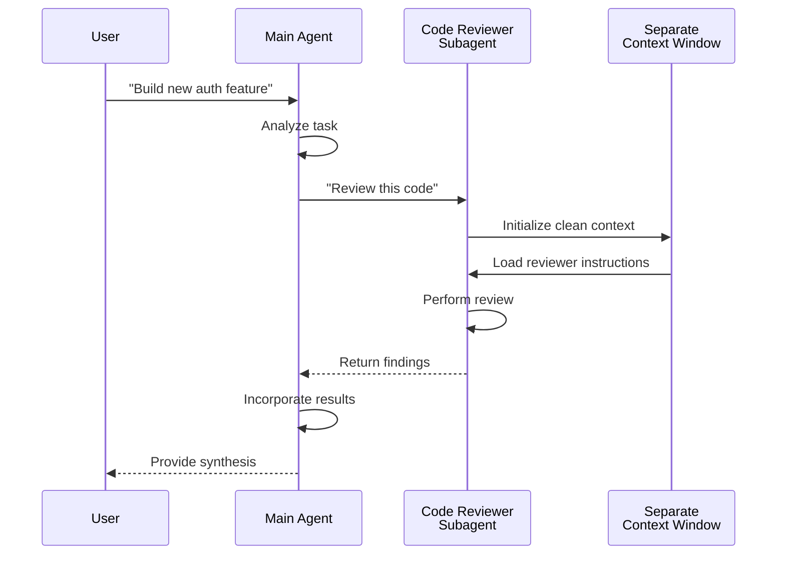

### Bảng Cấu Hình Tác Nhân Con

| Cấu Hình | Kiểu | Mục Đích | Ví Dụ |
|---------------|------|---------|---------|
| `name` | String | Định danh tác nhân | `code-reviewer` |
| `description` | String | Mục đích & từ kích hoạt | `Comprehensive code quality analysis` |
| `tools` | List/String | Các công cụ được phép | `Read, Grep, Glob, Bash` |
| *(phần thân markdown)* | Markdown | System prompt / hướng dẫn hành vi | Hướng dẫn tùy chỉnh |

### Phân Cấp Quyền Truy Cập Công Cụ

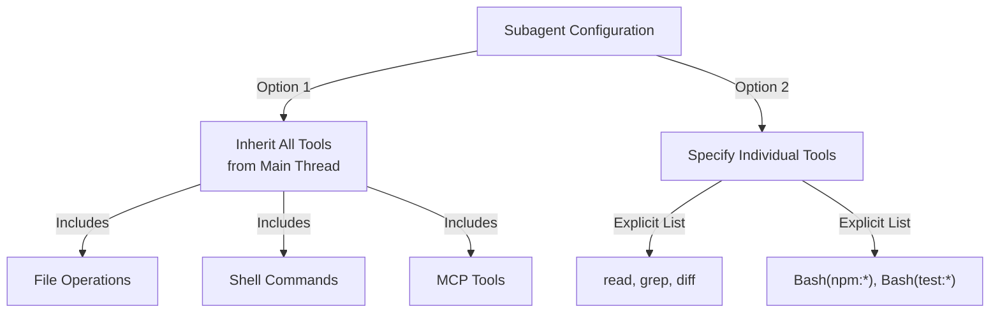

### Ví Dụ Thực Tế

Chín định nghĩa tác nhân con dùng ngay nằm trong **[04-subagents/](04-subagents/)**: `code-reviewer`, `clean-code-reviewer`, `secure-reviewer`, `test-engineer`, `documentation-writer`, `implementation-agent`, `performance-optimizer`, `debugger` và `data-scientist`.

**[04-subagents/README.md](04-subagents/README.md)** ghi lại tài liệu tham khảo frontmatter đầy đủ, quy tắc truy cập công cụ, giới hạn lồng nhau và Agent Teams.

### Quản Lý Ngữ Cảnh Của Tác Nhân Con

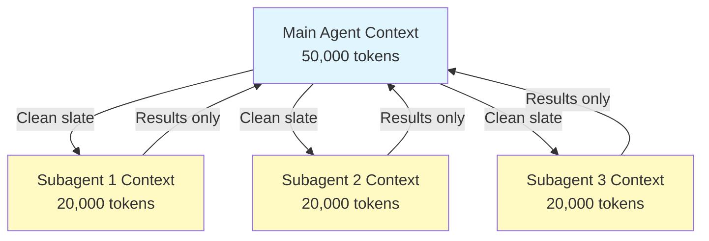

### Khi Nào Dùng Tác Nhân Con

| Tình Huống | Dùng Tác Nhân Con | Lý Do |
|----------|--------------|-----|
| Tính năng phức tạp với nhiều bước | ✅ Có | Tách biệt mối quan tâm, tránh làm "ô nhiễm" ngữ cảnh |
| Review code nhanh | ❌ Không | Chi phí không cần thiết |
| Thực thi tác vụ song song | ✅ Có | Mỗi tác nhân con có ngữ cảnh riêng |
| Cần chuyên môn đặc thù | ✅ Có | System prompt tùy chỉnh |
| Phân tích chạy lâu | ✅ Có | Tránh cạn kiệt ngữ cảnh chính |
| Tác vụ đơn lẻ | ❌ Không | Tăng độ trễ không cần thiết |

### Agent Teams

Agent Teams điều phối nhiều tác nhân cùng làm việc trên các tác vụ liên quan. Thay vì ủy quyền cho từng tác nhân con một, Agent Teams cho phép tác nhân chính điều phối một nhóm tác nhân cộng tác, chia sẻ kết quả trung gian và cùng hướng tới một mục tiêu chung. Điều này hữu ích cho các tác vụ quy mô lớn như phát triển tính năng full-stack, khi một tác nhân frontend, một tác nhân backend và một tác nhân kiểm thử làm việc song song.

---

## Bộ Nhớ

### Tổng Quan

Bộ nhớ cho phép Claude lưu giữ ngữ cảnh xuyên suốt các phiên và cuộc hội thoại. Nó tồn tại dưới hai dạng: tổng hợp tự động trong claude.ai, và CLAUDE.md dựa trên filesystem trong Claude Code.

### Kiến Trúc Bộ Nhớ

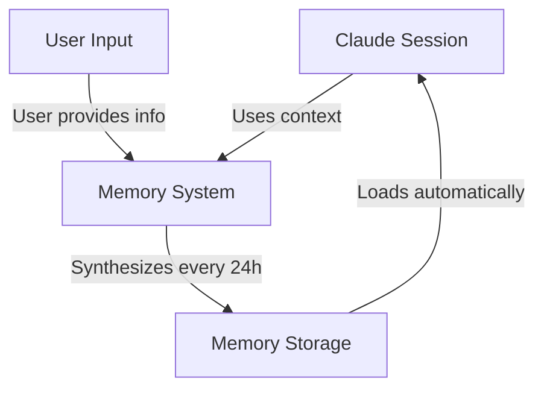

### Phân Cấp Bộ Nhớ Trong Claude Code (7 Tầng)

Claude Code nạp bộ nhớ từ 7 tầng. Các file CLAUDE.md được nối vào ngữ cảnh chứ không ghi đè lên nhau, và chúng được nạp theo thứ tự managed → user → project → local (các file cụ thể hơn, nạp sau, được đọc cuối cùng):

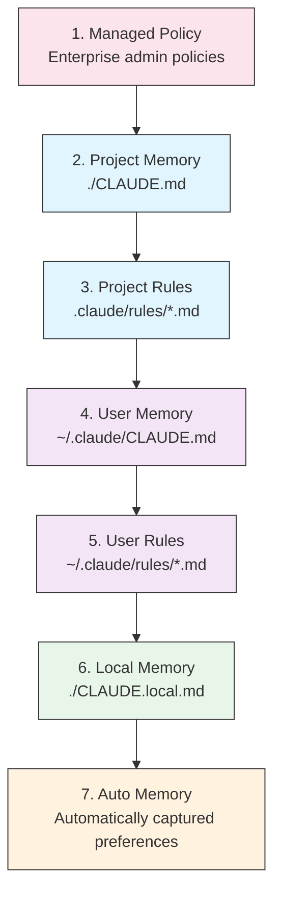

### Bảng Vị Trí Bộ Nhớ

| Tầng | Vị Trí | Phạm Vi | Độ Ưu Tiên | Chia Sẻ | Phù Hợp Nhất Cho |
|------|----------|-------|----------|--------|----------|
| 1. Managed Policy | Quản trị viên doanh nghiệp | Tổ chức | Cao nhất | Mọi người dùng trong tổ chức | Tuân thủ, chính sách bảo mật |
| 2. Project | `./CLAUDE.md` | Dự án | Cao | Đội (Git) | Tiêu chuẩn đội, kiến trúc |
| 3. Project Rules | `.claude/rules/*.md` | Dự án | Cao | Đội (Git) | Quy ước dự án dạng module |
| 4. User | `~/.claude/CLAUDE.md` | Cá nhân | Trung bình | Cá nhân | Tùy chọn cá nhân |
| 5. User Rules | `~/.claude/rules/*.md` | Cá nhân | Trung bình | Cá nhân | Các module quy tắc cá nhân |
| 6. Local | `./CLAUDE.local.md` | Cục bộ | Thấp | Không chia sẻ | Thiết lập riêng cho từng máy |
| 7. Auto Memory | Tự động | Theo từng kho chứa | Thấp nhất | Cá nhân | Tùy chọn và pattern đã học được |

### Auto Memory

Auto Memory tự động ghi nhận các tùy chọn và pattern của người dùng được quan sát trong các phiên. Claude học từ các tương tác của bạn và ghi nhớ:

- Tùy chọn về phong cách code
- Những chỉnh sửa bạn thường thực hiện
- Lựa chọn framework và công cụ
- Tùy chọn về phong cách giao tiếp

Auto Memory hoạt động ngầm và không cần cấu hình thủ công.

### Vòng Đời Cập Nhật Bộ Nhớ

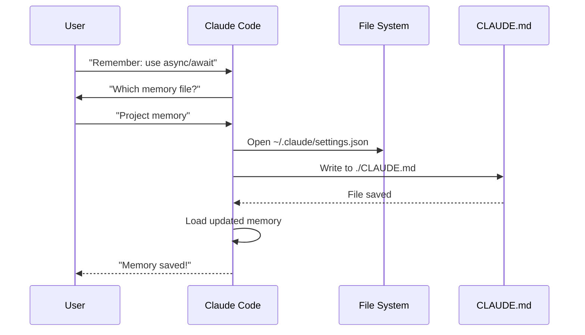

### Ví Dụ Thực Tế

Các template bộ nhớ copy-paste nằm trong **[02-memory/](02-memory/)**:

- **`project-CLAUDE.md`**: tiêu chuẩn dự án dùng cho cả đội, đặt tại `./CLAUDE.md`
- **`personal-CLAUDE.md`**: tùy chọn cá nhân, đặt tại `~/.claude/CLAUDE.md`
- **`directory-api-CLAUDE.md`**: tiêu chuẩn theo phạm vi thư mục cho một cây thư mục con

**[02-memory/README.md](02-memory/README.md)** trình bày đầy đủ hệ phân cấp, cú pháp import, `.claude/rules/`, auto memory và cách giữ CLAUDE.md dưới 200 dòng.

### Bộ Nhớ Trong Claude Web/Desktop

#### Dòng Thời Gian Tổng Hợp Bộ Nhớ


### Nội Dung Của Auto Memory

Auto memory lưu những gì Claude học được về bạn qua các phiên trong `~/.claude/projects/<project>/memory/`, được lập chỉ mục bởi `MEMORY.md`. Xem **[02-memory/README.md](02-memory/README.md)** để biết cấu trúc file, giới hạn nạp và cách bật hoặc tắt tính năng này.

### So Sánh Tính Năng Bộ Nhớ

| Tính Năng | Claude Web/Desktop | Claude Code (CLAUDE.md) |
|---------|-------------------|------------------------|
| Tự động tổng hợp | ✅ Mỗi 24 giờ | ❌ Thủ công |
| Dùng chung giữa các dự án | ✅ Chia sẻ | ❌ Riêng cho từng dự án |
| Truy cập theo đội | ✅ Dự án chia sẻ | ✅ Theo dõi bằng Git |
| Tìm kiếm được | ✅ Tích hợp sẵn | ✅ Thông qua `/memory` |
| Chỉnh sửa được | ✅ Trong chat | ✅ Sửa trực tiếp file |
| Nhập/Xuất | ✅ Có | ✅ Copy/paste |
| Lưu trữ lâu dài | ✅ Từ 24 giờ trở lên | ✅ Vô thời hạn |

---

## Giao Thức MCP

### Tổng Quan

MCP (Model Context Protocol) là cách thức chuẩn hóa để Claude truy cập các công cụ bên ngoài, API và nguồn dữ liệu thời gian thực. Khác với Bộ Nhớ, MCP cung cấp quyền truy cập trực tiếp vào dữ liệu luôn thay đổi.

### Kiến Trúc MCP

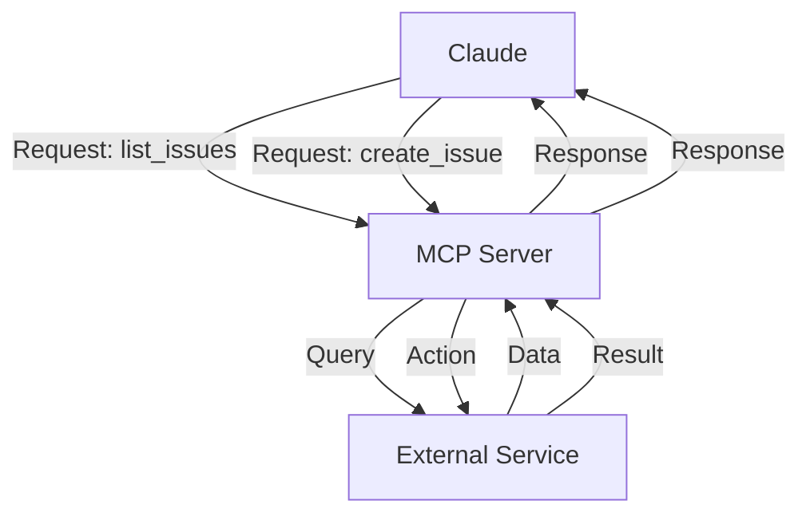

### Hệ Sinh Thái MCP

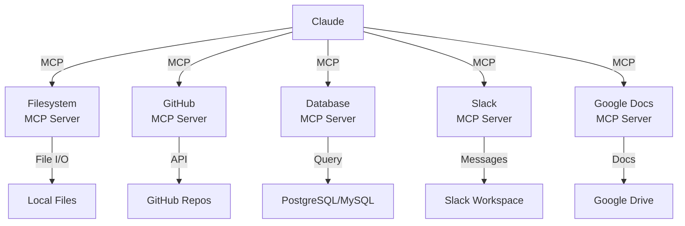

### Quy Trình Thiết Lập MCP

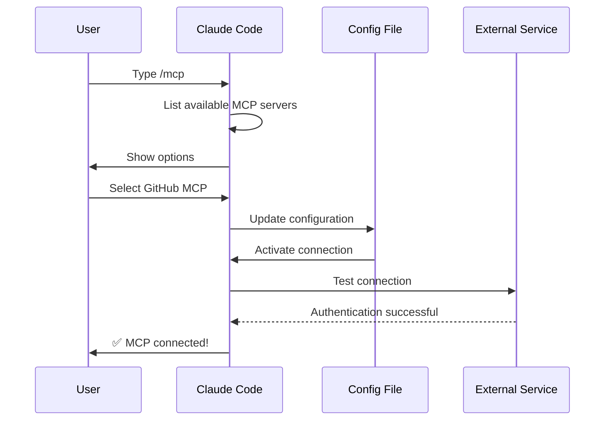

### Bảng Các MCP Server Có Sẵn

| MCP Server | Mục Đích | Công Cụ Phổ Biến | Xác Thực | Thời Gian Thực |
|------------|---------|--------------|------|-----------|
| **Filesystem** | Thao tác file | read, write, delete | Quyền hệ điều hành | ✅ Có |
| **GitHub** | Quản lý kho chứa | list_prs, create_issue, push | OAuth | ✅ Có |
| **Slack** | Giao tiếp nhóm | send_message, list_channels | Token | ✅ Có |
| **Database** | Truy vấn SQL | query, insert, update | Thông tin đăng nhập | ✅ Có |
| **Google Docs** | Truy cập tài liệu | read, write, share | OAuth | ✅ Có |
| **Asana** | Quản lý dự án | create_task, update_status | API Key | ✅ Có |
| **Stripe** | Dữ liệu thanh toán | list_charges, create_invoice | API Key | ✅ Có |
| **Memory** | Bộ nhớ lâu dài | store, retrieve, delete | Cục bộ | ❌ Không |

### Ví Dụ Thực Tế

Các cấu hình MCP server dùng ngay nằm trong **[05-mcp/](05-mcp/)**: `github-mcp.json`, `database-mcp.json`, `filesystem-mcp.json` và `multi-mcp.json` (bốn server trong một file).

**[05-mcp/README.md](05-mcp/README.md)** trình bày đầy đủ cú pháp `claude mcp add`, các transport, phạm vi, OAuth và danh sách cho phép (allowlist) cho doanh nghiệp.

### MCP và Bộ Nhớ: Ma Trận Ra Quyết Định

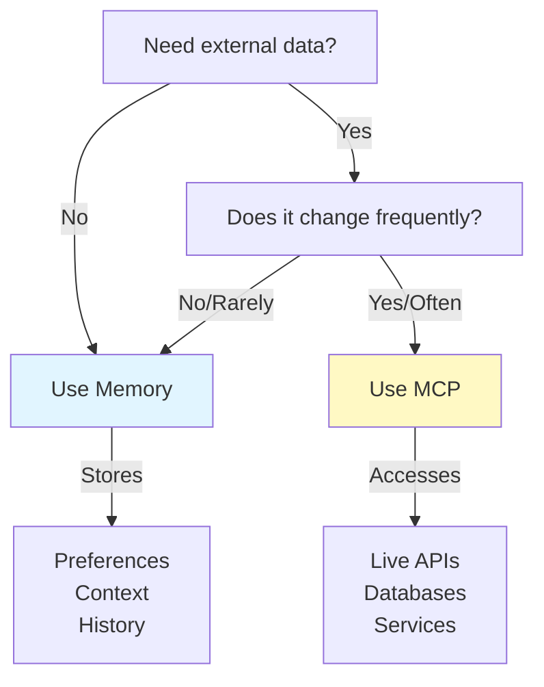

### Mẫu Request/Response

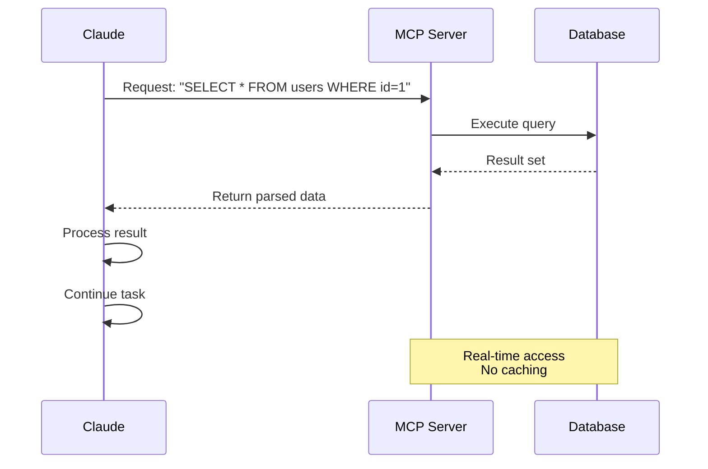

---

## Agent Skills

### Tổng Quan

Agent Skills là các khả năng có thể tái sử dụng, do mô hình tự gọi, được đóng gói thành các thư mục chứa hướng dẫn, script và tài nguyên. Claude tự động phát hiện và sử dụng các skill phù hợp.

### Kiến Trúc Skill

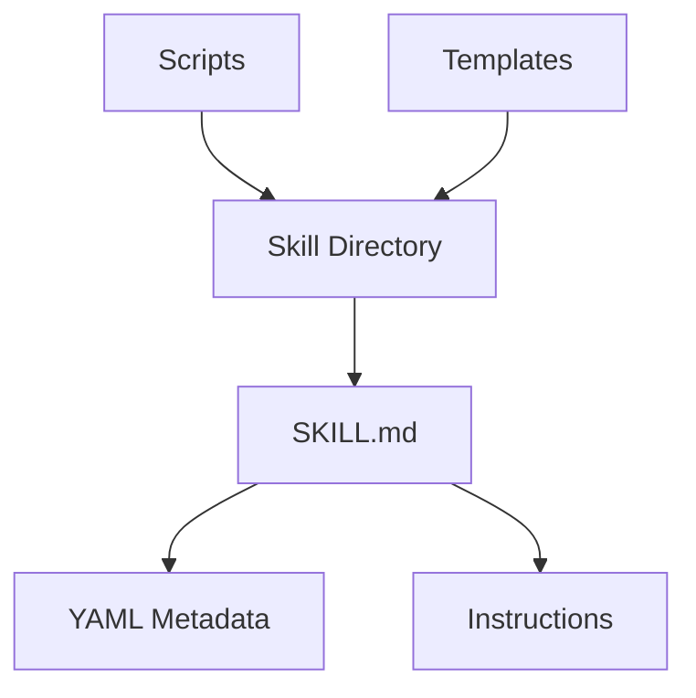

### Quy Trình Nạp Skill

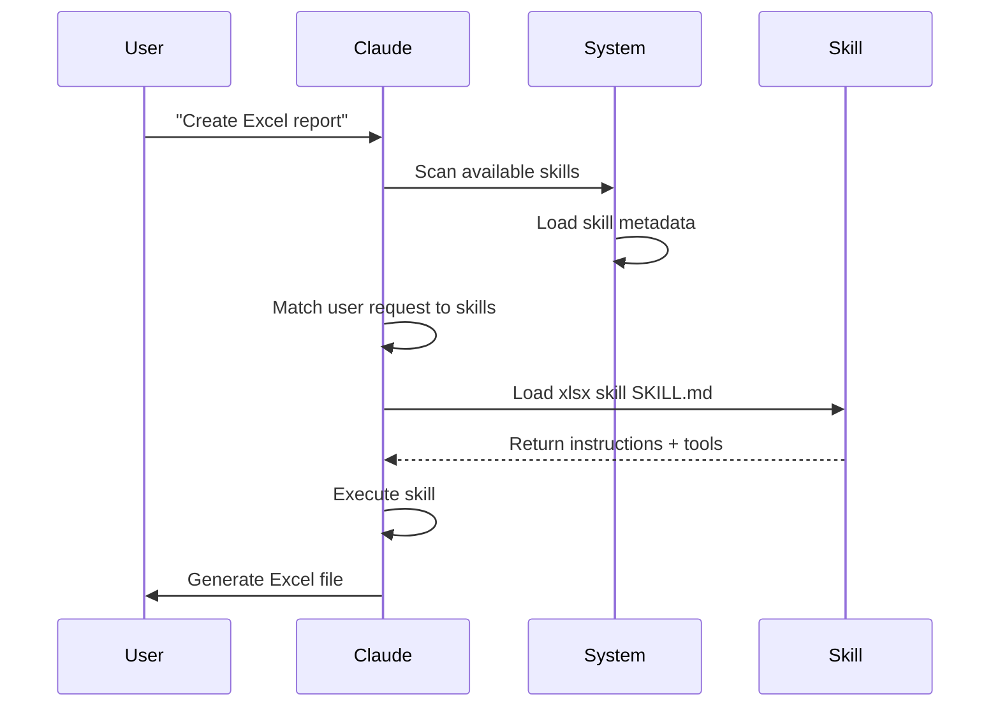

### Bảng Loại & Vị Trí Skill

| Loại | Vị Trí | Phạm Vi | Chia Sẻ | Đồng Bộ | Phù Hợp Nhất Cho |
|------|----------|-------|--------|------|----------|
| Dựng sẵn | Tích hợp sẵn | Toàn cục | Mọi người dùng | Tự động | Tạo tài liệu |
| Cá nhân | `~/.claude/skills/` | Cá nhân | Không | Thủ công | Tự động hóa cá nhân |
| Dự án | `.claude/skills/` | Đội | Có | Git | Tiêu chuẩn đội |
| Plugin | Qua cài đặt plugin | Tùy trường hợp | Tùy trường hợp | Tự động | Tính năng tích hợp |

### Skills Dựng Sẵn

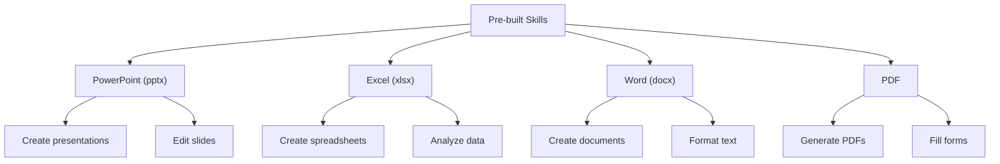

### Skills Đi Kèm

Claude Code có sẵn các skill đi kèm dùng được ngay, bao gồm:

| Skill | Lệnh | Mục Đích |
|-------|---------|---------|
| **Batch** | `/batch` | Chạy thao tác trên nhiều file hoặc nhiều mục |
| **Claude API** | `/claude-api` | Nạp tài liệu tham khảo Claude API và Managed Agents cho ngôn ngữ của dự án; tự động kích hoạt khi code của bạn import `anthropic` hoặc `@anthropic-ai/sdk` |
| **Code Review** | `/code-review` | Review diff hiện tại để tìm lỗi về tính đúng đắn ở mức nỗ lực tùy chọn. Đây là skill riêng biệt với `/simplify` (dọn dẹp về chất lượng/tái sử dụng), vốn được tách ra lại từ v2.1.154. Claude cũng có thể tự khởi chạy nó, ở mọi nơi kể từ v2.1.246 |
| **Simplify** | `/simplify` | Review về chất lượng, tái sử dụng và dọn dẹp; lại tách biệt với `/code-review` kể từ v2.1.154 |
| **Debug** | `/debug` | Bật ghi log debug cho phiên hiện tại và xử lý sự cố bằng cách đọc log debug của phiên |
| **Fewer Permission Prompts** | `/fewer-permission-prompts` | Quét transcript và đề xuất danh sách cho phép (allowlist) có thứ tự ưu tiên cho các công cụ chỉ-đọc phổ biến |
| **Loop** | `/loop` | Lên lịch các tác vụ lặp lại theo bộ hẹn giờ |
| **Run** | `/run` | Khởi chạy và điều khiển ứng dụng của dự án để kiểm chứng một thay đổi (v2.1.145+) |
| **Run Skill Generator** | `/run-skill-generator` | Viết một skill riêng cho dự án, dạy `/run` và `/verify` cách build, khởi chạy và điều khiển ứng dụng của bạn (v2.1.145+) |
| **Verify** | `/verify` | Kiểm chứng rằng một thay đổi thực sự hoạt động (v2.1.145+). Chỉ gọi tường minh kể từ v2.1.215 |

Các skill đi kèm này luôn khả dụng và không cần cài đặt hay cấu hình.

### Ví Dụ Thực Tế

Sáu skill hoàn chỉnh, kèm script, template và file tham khảo, nằm trong **[03-skills/](03-skills/)**:

- **`code-review-specialist/`**: checklist review, template ghi nhận phát hiện và hai script Python đo lường
- **`refactor/`**: danh mục code smell, danh mục refactoring, template kế hoạch và hai script phân tích
- **`doc-generator/`**: tạo tài liệu API từ mã nguồn
- **`blog-draft/`**: template dàn ý và bản nháp với quy ước đầu ra có đánh phiên bản
- **`brand-voice/`**: quy tắc giọng điệu và template tin nhắn (minh họa `user-invocable: false`)
- **`claude-md/`**: tạo, cập nhật và kiểm tra các file CLAUDE.md

Xem **[03-skills/README.md](03-skills/README.md)** để có tài liệu tham khảo frontmatter đầy đủ và mô hình tiết lộ dần (progressive disclosure).

### Phát Hiện & Gọi Skill

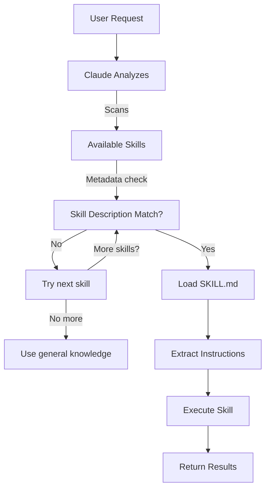

### Skill So Với Các Tính Năng Khác

```mermaid
graph TB
    A["Extending Claude"]
    B["Slash Commands"]
    C["Subagents"]
    D["Memory"]
    E["MCP"]
    F["Skills"]

    A --> B
    A --> C
    A --> D
    A --> E
    A --> F

    B -->|User-invoked| G["Quick shortcuts"]
    C -->|Auto-delegated| H["Isolated contexts"]
    D -->|Persistent| I["Cross-session context"]
    E -->|Real-time| J["External data access"]
    F -->|Auto-invoked| K["Autonomous execution"]
```

---

## Plugins Của Claude Code

### Tổng Quan

Plugins của Claude Code là các bộ sưu tập tùy chỉnh được đóng gói sẵn (lệnh slash, tác nhân con, MCP server và hook), cài đặt chỉ bằng một lệnh. Chúng là cơ chế mở rộng ở cấp cao nhất: kết hợp nhiều tính năng thành các gói thống nhất, có thể chia sẻ.

### Kiến Trúc

```mermaid
graph TB
    A["Plugin"]
    B["Slash Commands"]
    C["Subagents"]
    D["MCP Servers"]
    E["Hooks"]
    F["Configuration"]

    A -->|bundles| B
    A -->|bundles| C
    A -->|bundles| D
    A -->|bundles| E
    A -->|bundles| F
```

### Quy Trình Nạp Plugin

```mermaid
sequenceDiagram
    participant User
    participant Claude as Claude Code
    participant Plugin as Plugin Marketplace
    participant Install as Installation
    participant SlashCmds as Slash Commands
    participant Subagents
    participant MCPServers as MCP Servers
    participant Hooks
    participant Tools as Configured Tools

    User->>Claude: claude --plugin-dir ./07-plugins/pr-review
    Claude->>Plugin: Download plugin manifest
    Plugin-->>Claude: Return plugin definition
    Claude->>Install: Extract components
    Install->>SlashCmds: Configure
    Install->>Subagents: Configure
    Install->>MCPServers: Configure
    Install->>Hooks: Configure
    SlashCmds-->>Tools: Ready to use
    Subagents-->>Tools: Ready to use
    MCPServers-->>Tools: Ready to use
    Hooks-->>Tools: Ready to use
    Tools-->>Claude: Plugin installed ✅
```

### Loại Plugin & Phân Phối

| Loại | Phạm Vi | Chia Sẻ | Đơn Vị Quản Lý | Ví Dụ |
|------|-------|--------|-----------|----------|
| Chính thức | Toàn cục | Mọi người dùng | Anthropic | PR Review, Security Guidance |
| Cộng đồng | Công khai | Mọi người dùng | Cộng đồng | DevOps, Data Science |
| Tổ chức | Nội bộ | Thành viên trong đội | Công ty | Tiêu chuẩn nội bộ, công cụ |
| Cá nhân | Cá nhân | Một người dùng | Lập trình viên | Workflow tùy chỉnh |

### Cấu Trúc Định Nghĩa Plugin

Manifest là file JSON tại `.claude-plugin/plugin.json`. Chỉ `name` là bắt buộc, và các key cấp cao nhất không được nhận diện sẽ bị loại bỏ:

```json
{
  "name": "plugin-name",
  "version": "1.0.0",
  "description": "What this plugin does"
}
```

### Cấu Trúc Plugin

```
my-plugin/
├── .claude-plugin/
│   └── plugin.json
├── commands/
│   ├── task-1.md
│   ├── task-2.md
│   └── workflows/
├── agents/
│   ├── specialist-1.md
│   ├── specialist-2.md
│   └── configs/
├── skills/
│   └── skill-name/
│       └── SKILL.md
├── hooks/
│   └── hooks.json
├── .mcp.json
├── bin/
│   └── my-tool
├── .lsp.json
├── settings.json
├── templates/
│   └── issue-template.md
├── scripts/
│   ├── helper-1.sh
│   └── helper-2.py
├── docs/
│   ├── README.md
│   └── USAGE.md
└── tests/
    └── plugin.test.js
```

### Ví Dụ Thực Tế

Ba plugin hoàn chỉnh, có thể cài đặt, nằm trong **[07-plugins/](07-plugins/)**:

- **`pr-review/`**: các lệnh review, ba tác nhân chuyên biệt, GitHub MCP và một pre-review hook
- **`documentation/`**: các lệnh tạo tài liệu, ba tác nhân và các template tái sử dụng
- **`devops-automation/`**: các lệnh deploy/rollback/status/incident, ba tác nhân, Kubernetes MCP và các shell script

Mỗi plugin có manifest `.claude-plugin/plugin.json` và cấu trúc thư mục riêng.

### Plugin Marketplace

```mermaid
graph TB
    A["Plugin Marketplace"]
    B["Official<br/>Anthropic"]
    C["Community<br/>Marketplace"]
    D["Enterprise<br/>Registry"]

    A --> B
    A --> C
    A --> D

    B -->|Categories| B1["Development"]
    B -->|Categories| B2["DevOps"]
    B -->|Categories| B3["Documentation"]

    C -->|Search| C1["DevOps Automation"]
    C -->|Search| C2["Mobile Dev"]
    C -->|Search| C3["Data Science"]

    D -->|Internal| D1["Company Standards"]
    D -->|Internal| D2["Legacy Systems"]
    D -->|Internal| D3["Compliance"]
```

### Cài Đặt & Vòng Đời Plugin

```mermaid
graph LR
    A["Discover"] -->|Browse| B["Marketplace"]
    B -->|Select| C["Plugin Page"]
    C -->|View| D["Components"]
    D -->|Install| E["/plugin install"]
    E -->|Extract| F["Configure"]
    F -->|Activate| G["Use"]
    G -->|Check| H["Update"]
    H -->|Available| G
    G -->|Done| I["Disable"]
    I -->|Later| J["Enable"]
    J -->|Back| G
```

### So Sánh Tính Năng Plugin

| Tính Năng | Lệnh Slash | Skill | Tác Nhân Con | Plugin |
|---------|---------------|-------|----------|--------|
| **Cài đặt** | Sao chép thủ công | Sao chép thủ công | Cấu hình thủ công | Một lệnh |
| **Thời gian thiết lập** | 5 phút | 10 phút | 15 phút | 2 phút |
| **Đóng gói** | Một file | Một file | Một file | Nhiều thành phần |
| **Quản lý phiên bản** | Thủ công | Thủ công | Thủ công | Tự động |
| **Chia sẻ trong đội** | Sao chép file | Sao chép file | Sao chép file | ID cài đặt |
| **Cập nhật** | Thủ công | Thủ công | Thủ công | Tự động có sẵn |
| **Dependencies** | Không | Không | Không | Có thể bao gồm |
| **Marketplace** | Không | Không | Không | Có |
| **Phân phối** | Kho chứa | Kho chứa | Kho chứa | Marketplace |

### Các Trường Hợp Dùng Plugin

| Trường Hợp | Khuyến Nghị | Lý Do |
|----------|-----------------|-----|
| **Onboarding thành viên mới** | ✅ Dùng Plugin | Thiết lập tức thì, đầy đủ mọi cấu hình |
| **Thiết lập framework** | ✅ Dùng Plugin | Đóng gói các lệnh riêng cho framework |
| **Tiêu chuẩn doanh nghiệp** | ✅ Dùng Plugin | Phân phối tập trung, quản lý phiên bản |
| **Tự động hóa tác vụ nhanh** | ❌ Dùng Lệnh | Quá phức tạp so với nhu cầu |
| **Chuyên môn một lĩnh vực** | ❌ Dùng Skill | Quá nặng, hãy dùng skill thay thế |
| **Phân tích chuyên biệt** | ❌ Dùng Tác Nhân Con | Tạo thủ công hoặc dùng skill |
| **Truy cập dữ liệu trực tiếp** | ❌ Dùng MCP | Dùng độc lập, không đóng gói |

### Khi Nào Nên Tạo Plugin

```mermaid
graph TD
    A["Should I create a plugin?"]
    A -->|Need multiple components| B{"Multiple commands<br/>or subagents<br/>or MCPs?"}
    B -->|Yes| C["✅ Create Plugin"]
    B -->|No| D["Use Individual Feature"]
    A -->|Team workflow| E{"Share with<br/>team?"}
    E -->|Yes| C
    E -->|No| F["Keep as Local Setup"]
    A -->|Complex setup| G{"Needs auto<br/>configuration?"}
    G -->|Yes| C
    G -->|No| D
```

### Xuất Bản Plugin

**Các bước xuất bản:**

1. Tạo cấu trúc plugin với đầy đủ các thành phần
2. Viết manifest `.claude-plugin/plugin.json`
3. Tạo `README.md` kèm tài liệu
4. Kiểm thử cục bộ bằng `claude --plugin-dir ./my-plugin`
5. Gửi lên plugin marketplace
6. Được review và phê duyệt
7. Được xuất bản trên marketplace
8. Người dùng có thể cài đặt bằng một lệnh

### Ví Dụ README Của Plugin

Xem ba plugin hoàn chỉnh trong **[07-plugins/](07-plugins/)**: `pr-review/`, `documentation/` và `devops-automation/`, mỗi plugin đều có sẵn `README.md` đầy đủ, manifest, các lệnh, tác nhân và cấu hình MCP để bạn sao chép nguyên vẹn.

### Plugin So Với Cấu Hình Thủ Công

**Thiết lập thủ công (hơn 2 giờ):**
- Cài từng lệnh slash một
- Tạo từng tác nhân con riêng lẻ
- Cấu hình MCP riêng biệt
- Thiết lập hook thủ công
- Viết tài liệu cho mọi thứ
- Chia sẻ với đội (và hy vọng mọi người cấu hình đúng)

**Với Plugin (2 phút):**
```bash
claude --plugin-dir ./07-plugins/pr-review
# ✅ Mọi thứ đã được cài đặt và cấu hình
# ✅ Sẵn sàng sử dụng ngay
# ✅ Cả đội có thể tái tạo chính xác cùng một thiết lập
```

---

## So Sánh & Tích Hợp

### Ma Trận So Sánh Tính Năng

| Tính Năng | Cách Gọi | Tính Lưu Trữ | Phạm Vi | Trường Hợp Sử Dụng |
|---------|-----------|------------|-------|----------|
| **Lệnh Slash** | Thủ công (`/cmd`) | Chỉ trong phiên | Một lệnh | Lối tắt nhanh |
| **Tác Nhân Con** | Tự động ủy quyền | Ngữ cảnh tách biệt | Tác vụ chuyên biệt | Phân phối tác vụ |
| **Bộ Nhớ** | Tự động nạp | Xuyên phiên | Ngữ cảnh người dùng/đội | Học hỏi dài hạn |
| **Giao Thức MCP** | Tự động truy vấn | Bên ngoài, thời gian thực | Truy cập dữ liệu trực tiếp | Thông tin động |
| **Skills** | Tự động gọi | Dựa trên filesystem | Chuyên môn tái sử dụng | Workflow tự động |

### Dòng Thời Gian Tương Tác

```mermaid
graph LR
    A["Session Start"] -->|Load| B["Memory (CLAUDE.md)"]
    B -->|Discover| C["Available Skills"]
    C -->|Register| D["Slash Commands"]
    D -->|Connect| E["MCP Servers"]
    E -->|Ready| F["User Interaction"]

    F -->|Type /cmd| G["Slash Command"]
    F -->|Request| H["Skill Auto-Invoke"]
    F -->|Query| I["MCP Data"]
    F -->|Complex task| J["Delegate to Subagent"]

    G -->|Uses| B
    H -->|Uses| B
    I -->|Uses| B
    J -->|Uses| B
```

### Ví Dụ Tích Hợp Thực Tế: Tự Động Hóa Hỗ Trợ Khách Hàng

#### Kiến Trúc

```mermaid
graph TB
    User["Customer Email"] -->|Receives| Router["Support Router"]

    Router -->|Analyze| Memory["Memory<br/>Customer history"]
    Router -->|Lookup| MCP1["MCP: Customer DB<br/>Previous tickets"]
    Router -->|Check| MCP2["MCP: Slack<br/>Team status"]

    Router -->|Route Complex| Sub1["Subagent: Tech Support<br/>Context: Technical issues"]
    Router -->|Route Simple| Sub2["Subagent: Billing<br/>Context: Payment issues"]
    Router -->|Route Urgent| Sub3["Subagent: Escalation<br/>Context: Priority handling"]

    Sub1 -->|Format| Skill1["Skill: Response Generator<br/>Brand voice maintained"]
    Sub2 -->|Format| Skill2["Skill: Response Generator"]
    Sub3 -->|Format| Skill3["Skill: Response Generator"]

    Skill1 -->|Generate| Output["Formatted Response"]
    Skill2 -->|Generate| Output
    Skill3 -->|Generate| Output

    Output -->|Post| MCP3["MCP: Slack<br/>Notify team"]
    Output -->|Send| Reply["Customer Reply"]
```

#### Luồng Xử Lý Yêu Cầu

```markdown
## Luồng Xử Lý Yêu Cầu Hỗ Trợ Khách Hàng

### 1. Email Đến
"Tôi gặp lỗi 500 khi cố tải file lên. Lỗi này đang chặn workflow của tôi!"

### 2. Tra Cứu Bộ Nhớ
- Nạp CLAUDE.md chứa các tiêu chuẩn hỗ trợ
- Kiểm tra lịch sử khách hàng: khách hàng VIP, sự cố thứ 3 trong tháng này

### 3. Truy Vấn MCP
- GitHub MCP: Liệt kê các issue đang mở (tìm thấy báo cáo lỗi liên quan)
- Database MCP: Kiểm tra trạng thái hệ thống (không có báo cáo sự cố gián đoạn)
- Slack MCP: Kiểm tra xem đội kỹ thuật đã biết chưa

### 4. Phát Hiện & Nạp Skill
- Yêu cầu khớp với skill "Technical Support"
- Nạp template phản hồi hỗ trợ từ Skill

### 5. Ủy Quyền Cho Tác Nhân Con
- Chuyển đến Tác Nhân Con Tech Support
- Cung cấp ngữ cảnh: lịch sử khách hàng, chi tiết lỗi, các vấn đề đã biết
- Tác nhân con có toàn quyền truy cập: các công cụ read, bash, grep

### 6. Tác Nhân Con Xử Lý
Tác Nhân Con Tech Support:
- Tìm kiếm codebase cho lỗi 500 ở chức năng tải file lên
- Tìm thấy thay đổi gần đây trong commit 8f4a2c
- Tạo tài liệu hướng dẫn giải pháp tạm thời

### 7. Thực Thi Skill
Skill Response Generator:
- Dùng các hướng dẫn Brand Voice
- Định dạng phản hồi với sự đồng cảm
- Bao gồm các bước giải pháp tạm thời
- Liên kết đến tài liệu liên quan

### 8. Đầu Ra MCP
- Đăng cập nhật lên kênh Slack #support
- Gắn thẻ đội kỹ thuật
- Cập nhật ticket trong Jira MCP

### 9. Phản Hồi
Khách hàng nhận được:
- Lời ghi nhận đầy đồng cảm
- Giải thích nguyên nhân
- Giải pháp tạm thời ngay lập tức
- Mốc thời gian cho bản sửa lỗi lâu dài
- Liên kết đến các issue liên quan
```

### Điều Phối Toàn Bộ Tính Năng

```mermaid
sequenceDiagram
    participant User
    participant Claude as Claude Code
    participant Memory as Memory<br/>CLAUDE.md
    participant MCP as MCP Servers
    participant Skills as Skills
    participant SubAgent as Subagents

    User->>Claude: Request: "Build auth system"
    Claude->>Memory: Load project standards
    Memory-->>Claude: Auth standards, team practices
    Claude->>MCP: Query GitHub for similar implementations
    MCP-->>Claude: Code examples, best practices
    Claude->>Skills: Detect matching Skills
    Skills-->>Claude: Security Review Skill + Testing Skill
    Claude->>SubAgent: Delegate implementation
    SubAgent->>SubAgent: Build feature
    Claude->>Skills: Apply Security Review Skill
    Skills-->>Claude: Security checklist results
    Claude->>SubAgent: Delegate testing
    SubAgent-->>Claude: Test results
    Claude->>User: Complete system delivered
```

### Khi Nào Dùng Từng Tính Năng

```mermaid
graph TD
    A["New Task"] --> B{Type of Task?}

    B -->|Repeated workflow| C["Slash Command"]
    B -->|Need real-time data| D["MCP Protocol"]
    B -->|Remember for next time| E["Memory"]
    B -->|Specialized subtask| F["Subagent"]
    B -->|Domain-specific work| G["Skill"]

    C --> C1["✅ Team shortcut"]
    D --> D1["✅ Live API access"]
    E --> E1["✅ Persistent context"]
    F --> F1["✅ Parallel execution"]
    G --> G1["✅ Auto-invoked expertise"]
```

### Cây Quyết Định Lựa Chọn

```mermaid
graph TD
    Start["Need to extend Claude?"]

    Start -->|Quick repeated task| A{"Manual or Auto?"}
    A -->|Manual| B["Slash Command"]
    A -->|Auto| C["Skill"]

    Start -->|Need external data| D{"Real-time?"}
    D -->|Yes| E["MCP Protocol"]
    D -->|No/Cross-session| F["Memory"]

    Start -->|Complex project| G{"Multiple roles?"}
    G -->|Yes| H["Subagents"]
    G -->|No| I["Skills + Memory"]

    Start -->|Long-term context| J["Memory"]
    Start -->|Team workflow| K["Slash Command +<br/>Memory"]
    Start -->|Full automation| L["Skills +<br/>Subagents +<br/>MCP"]
```

---

## Bảng Tóm Tắt

| Khía Cạnh | Lệnh Slash | Tác Nhân Con | Bộ Nhớ | MCP | Skills | Plugins |
|--------|---|---|---|---|---|---|
| **Độ khó thiết lập** | Dễ | Trung bình | Dễ | Trung bình | Trung bình | Dễ |
| **Đường cong học tập** | Thấp | Trung bình | Thấp | Trung bình | Trung bình | Thấp |
| **Lợi ích cho đội** | Cao | Cao | Trung bình | Cao | Cao | Rất cao |
| **Mức độ tự động hóa** | Thấp | Cao | Trung bình | Cao | Cao | Rất cao |
| **Quản lý ngữ cảnh** | Một phiên | Tách biệt | Lâu dài | Thời gian thực | Lâu dài | Mọi tính năng |
| **Gánh nặng bảo trì** | Thấp | Trung bình | Thấp | Trung bình | Trung bình | Thấp |
| **Khả năng mở rộng** | Tốt | Xuất sắc | Tốt | Xuất sắc | Xuất sắc | Xuất sắc |
| **Khả năng chia sẻ** | Khá | Khá | Tốt | Tốt | Tốt | Xuất sắc |
| **Quản lý phiên bản** | Thủ công | Thủ công | Thủ công | Thủ công | Thủ công | Tự động |
| **Cài đặt** | Sao chép thủ công | Cấu hình thủ công | Không áp dụng | Cấu hình thủ công | Sao chép thủ công | Một lệnh |

---

## Hướng Dẫn Bắt Đầu Nhanh

### Tuần 1: Bắt Đầu Đơn Giản
- Tạo 2-3 lệnh slash cho các tác vụ thường gặp
- Bật Bộ Nhớ trong Settings
- Ghi lại tiêu chuẩn của đội trong CLAUDE.md

### Tuần 2: Thêm Truy Cập Thời Gian Thực
- Thiết lập 1 MCP (GitHub hoặc Database)
- Dùng `/mcp` để cấu hình
- Truy vấn dữ liệu trực tiếp trong workflow của bạn

### Tuần 3: Phân Phối Công Việc
- Tạo Tác Nhân Con đầu tiên cho một vai trò cụ thể
- Yêu cầu Claude tạo nó, hoặc thêm file `.claude/agents/<name>.md` (trình hướng dẫn `/agents` đã bị gỡ bỏ)
- Kiểm thử việc ủy quyền với một tác vụ đơn giản

### Tuần 4: Tự Động Hóa Mọi Thứ
- Tạo Skill đầu tiên cho tác vụ tự động hóa lặp lại
- Dùng Skill marketplace hoặc tự xây dựng
- Kết hợp mọi tính năng thành một workflow hoàn chỉnh

### Duy Trì Liên Tục
- Xem lại và cập nhật Bộ Nhớ hằng tháng
- Thêm Skill mới khi xuất hiện các pattern mới
- Tối ưu hóa các truy vấn MCP
- Tinh chỉnh prompt của Tác Nhân Con

---

## Hooks

### Tổng Quan

Hooks là các lệnh shell hướng sự kiện, tự động thực thi để phản hồi các sự kiện của Claude Code. Chúng cho phép tự động hóa, kiểm tra hợp lệ và tạo workflow tùy chỉnh mà không cần can thiệp thủ công.

### Các Sự Kiện Hook

Claude Code hỗ trợ **33 sự kiện hook** với năm loại hook (command, http, mcp_tool, prompt, agent):

| Sự Kiện Hook | Kích Hoạt Khi | Trường Hợp Sử Dụng |
|------------|---------|-----------|
| **SessionStart** | Phiên bắt đầu/tiếp tục/clear/compact | Thiết lập môi trường, khởi tạo |
| **Setup** | Khởi chạy với `--init-only`, hoặc `-p` kèm `--init` / `--maintenance` (không chạy khi khởi động bình thường) | Chuẩn bị công cụ, cài đặt dependencies |
| **InstructionsLoaded** | File CLAUDE.md hoặc file rules được nạp | Kiểm tra hợp lệ, chuyển đổi, bổ sung |
| **UserPromptSubmit** | Người dùng gửi prompt | Kiểm tra đầu vào, lọc prompt |
| **UserPromptExpansion** | Lệnh slash được gõ (skill, lệnh tùy chỉnh, MCP prompt) được mở rộng thành prompt; có thể chặn nó | Chặn hoặc ghi log việc dùng `/command` trực tiếp, thêm ngữ cảnh theo từng skill |
| **PreToolUse** | Trước khi bất kỳ công cụ nào chạy | Kiểm tra hợp lệ, cổng phê duyệt, ghi log |
| **PermissionRequest** | Hộp thoại cấp quyền hiển thị | Luồng tự động chấp thuận/từ chối |
| **PermissionDenied** | Chế độ auto từ chối một lệnh gọi công cụ (không bao giờ kích hoạt khi từ chối thủ công) | Ghi log, phân tích, thực thi chính sách |
| **PostToolUse** | Sau khi công cụ chạy thành công | Tự động định dạng, thông báo, dọn dẹp |
| **PostToolUseFailure** | Công cụ thực thi thất bại | Xử lý lỗi, ghi log |
| **PostToolBatch** | Sau khi một loạt lệnh gọi công cụ hoàn tất | Báo cáo tổng hợp, kiểm tra hợp lệ theo loạt |
| **Notification** | Thông báo được gửi | Cảnh báo, tích hợp bên ngoài |
| **MessageDisplay** | Trong khi văn bản tin nhắn của trợ lý đang hiển thị | Chuyển đổi hoặc ẩn văn bản tin nhắn hiển thị |
| **SubagentStart** | Tác nhân con được tạo | Chèn ngữ cảnh, khởi tạo |
| **SubagentStop** | Tác nhân con hoàn tất | Kiểm tra kết quả, ghi log |
| **Stop** | Claude trả lời xong | Tạo tóm tắt, tác vụ dọn dẹp |
| **StopFailure** | Lỗi API kết thúc lượt | Khôi phục lỗi, ghi log |
| **TeammateIdle** | Thành viên trong agent team rảnh | Phân phối công việc, điều phối |
| **TaskCompleted** | Tác vụ được đánh dấu hoàn thành. Chỉ kích hoạt khi các công cụ todo được bật; mặc định chỉ có trên các mô hình Claude 3.x, Opus 4 đến 4.7, Sonnet 4 đến 4.6 và Haiku 4.5; `CLAUDE_CODE_ENABLE_TODO_TOOLS=1` khôi phục chúng (v2.1.233) | Xử lý sau tác vụ |
| **TaskCreated** | Tác vụ được tạo qua TaskCreate. Chỉ kích hoạt khi các công cụ todo được bật; mặc định chỉ có trên các mô hình Claude 3.x, Opus 4 đến 4.7, Sonnet 4 đến 4.6 và Haiku 4.5; `CLAUDE_CODE_ENABLE_TODO_TOOLS=1` khôi phục chúng (v2.1.233) | Theo dõi tác vụ, ghi log |
| **ConfigChange** | File cấu hình thay đổi | Kiểm tra hợp lệ, lan truyền thay đổi |
| **CwdChanged** | Thư mục làm việc thay đổi | Thiết lập riêng theo thư mục |
| **DirectoryAdded** | Thư mục làm việc mới được đăng ký giữa phiên qua `/add-dir` hoặc control request `register_repo_root` của SDK | Thiết lập công cụ cho thư mục vừa thêm |
| **FileChanged** | File đang được theo dõi thay đổi | Giám sát file, kích hoạt build lại |
| **PreCompact** | Trước khi nén ngữ cảnh | Bảo toàn trạng thái |
| **PostCompact** | Sau khi nén hoàn tất | Hành động sau khi nén |
| **PreModelSwitch** | Trước khi áp dụng yêu cầu chuyển mô hình | Kiểm soát hoặc phủ quyết việc đổi mô hình |
| **PostModelSwitch** | Sau khi mô hình của phiên thay đổi | Ghi log hoặc phản ứng với việc đổi mô hình |
| **WorktreeCreate** | Worktree đang được tạo | Thay thế cách tạo git worktree mặc định; phải in ra đường dẫn worktree |
| **WorktreeRemove** | Worktree đang bị xóa | Dọn dẹp, giải phóng tài nguyên |
| **Elicitation** | MCP server yêu cầu người dùng nhập liệu | Kiểm tra đầu vào |
| **ElicitationResult** | Người dùng phản hồi yêu cầu nhập liệu | Xử lý phản hồi |
| **SessionEnd** | Phiên kết thúc | Dọn dẹp, ghi log cuối cùng |

### Các Hook Thông Dụng

Hooks được cấu hình trong `~/.claude/settings.json` (cấp người dùng) hoặc `.claude/settings.json` (cấp dự án):

```json
{
  "hooks": {
    "PostToolUse": [
      {
        "matcher": "Write",
        "hooks": [
          {
            "type": "command",
            "command": "jq -r '.tool_input.file_path' | xargs npx prettier --write"
          }
        ]
      }
    ],
    "PreToolUse": [
      {
        "matcher": "Edit",
        "hooks": [
          {
            "type": "command",
            "command": "jq -r '.tool_input.file_path' | xargs npx eslint"
          }
        ]
      }
    ]
  }
}
```

### Biến Môi Trường Của Hook

- Đầu vào của hook được gửi dưới dạng JSON qua stdin (`session_id`, `tool_name`, `tool_input.file_path`, …); đọc nó bằng `jq`
- `$CLAUDE_CODE_SESSION_ID` - Định danh phiên hiện tại
- `$CLAUDE_PROJECT_DIR` - Đường dẫn thư mục dự án

### Thực Hành Tốt Nhất

✅ **Nên:**
- Giữ hook chạy nhanh (< 1 giây)
- Dùng hook cho kiểm tra hợp lệ và tự động hóa
- Xử lý lỗi một cách êm thấm
- Dùng đường dẫn tuyệt đối

❌ **Không nên:**
- Làm hook có tính tương tác
- Dùng hook cho các tác vụ chạy lâu
- Hardcode thông tin đăng nhập

**Xem**: [06-hooks/](06-hooks/) để có ví dụ chi tiết

---

## Checkpoints và Rewind

### Tổng Quan

Checkpoint cho phép bạn lưu trạng thái hội thoại và quay lại (rewind) các thời điểm trước đó, giúp thử nghiệm an toàn và khám phá nhiều hướng tiếp cận.

### Khái Niệm Chính

| Khái Niệm | Mô Tả |
|---------|-------------|
| **Checkpoint** | Snapshot của trạng thái hội thoại bao gồm tin nhắn, file và ngữ cảnh |
| **Rewind** | Quay lại một checkpoint trước đó, loại bỏ các thay đổi sau đó |
| **Branch Point** | Checkpoint làm điểm xuất phát để khám phá nhiều hướng tiếp cận |

### Truy Cập Checkpoint

Checkpoint được tạo tự động với mỗi prompt của người dùng. Để rewind:

```bash
# Nhấn Esc hai lần để mở trình duyệt checkpoint
Esc + Esc

# Hoặc dùng lệnh /rewind
/rewind
```

Khi chọn một checkpoint, bạn có sáu tùy chọn:
1. **Restore code and conversation**: Khôi phục cả hai về thời điểm đó
2. **Restore conversation**: Rewind tin nhắn, giữ code hiện tại
3. **Restore code**: Khôi phục file, giữ hội thoại
4. **Summarize from here**: Nén hội thoại thành bản tóm tắt
5. **Summarize up to here**: Nén mọi thứ trước thời điểm này thành bản tóm tắt
6. **Never mind**: Hủy

### Trường Hợp Sử Dụng

| Tình Huống | Workflow |
|----------|----------|
| **Khám phá các hướng tiếp cận** | Lưu → Thử A → Lưu → Rewind → Thử B → So sánh |
| **Refactor an toàn** | Lưu → Refactor → Test → Nếu thất bại: Rewind |
| **A/B Testing** | Lưu → Thiết kế A → Lưu → Rewind → Thiết kế B → So sánh |
| **Khôi phục sau sai sót** | Phát hiện vấn đề → Rewind về trạng thái tốt gần nhất |

### Cấu Hình

Checkpoint được bật mặc định; `fileCheckpointingEnabled` điều khiển tính năng này:

```json
{
  "fileCheckpointingEnabled": true
}
```

**Xem**: [08-checkpoints/](08-checkpoints/) để có ví dụ chi tiết

---

## Tính Năng Nâng Cao

### Chế Độ Lập Kế Hoạch

Tạo kế hoạch triển khai chi tiết trước khi viết code.

**Kích hoạt:**
```bash
/plan Implement user authentication system
```

**Lợi ích:**
- Lộ trình rõ ràng kèm ước tính thời gian
- Đánh giá rủi ro
- Chia nhỏ tác vụ có hệ thống
- Cơ hội để review và điều chỉnh

### Extended Thinking

Suy luận sâu cho các vấn đề phức tạp.

**Kích hoạt:**
- Bật/tắt bằng `Alt+T` (hoặc `Option+T` trên macOS) trong phiên làm việc
- Opus 4.7+, Sonnet 5+, Haiku 5.5 và Fable luôn dùng suy luận thích ứng, vì vậy ngân sách cố định `MAX_THINKING_TOKENS` không áp dụng; hãy điều khiển độ sâu bằng `/effort`

```bash
# Điều khiển độ sâu suy luận bằng mức effort
/effort high
```

**Lợi ích:**
- Phân tích kỹ lưỡng các đánh đổi
- Quyết định kiến trúc tốt hơn
- Cân nhắc các trường hợp biên
- Đánh giá có hệ thống

### Tác Vụ Nền

Chạy các thao tác dài mà không chặn cuộc hội thoại.

**Cách dùng:**
```bash
User: Run tests in background

Claude: Started task bg-1234

/tasks               # Xem và quản lý công việc chạy nền (alias: /bashes)
```

### Chế Độ Cấp Quyền

Kiểm soát những gì Claude được phép làm.

| Chế Độ | Mô Tả | Trường Hợp Sử Dụng |
|------|-------------|----------|
| **manual** | Quyền tiêu chuẩn, hỏi xác nhận với các hành động nhạy cảm (hiển thị là Manual kể từ v2.1.200; giá trị cấu hình vẫn là `default`, và hooks cùng SDK báo cáo giá trị này) | Phát triển thông thường |
| **acceptEdits** | Tự động chấp nhận chỉnh sửa file mà không cần xác nhận | Workflow chỉnh sửa đáng tin cậy |
| **plan** | Chỉ phân tích và lập kế hoạch, không sửa file | Review code, lập kế hoạch kiến trúc |
| **auto** | Một bộ phân loại chấp thuận hành động an toàn và chặn hành động rủi ro; chỉ hỏi lại sau 3 lần chặn liên tiếp hoặc tổng cộng 20 lần | Cân bằng giữa tự chủ và an toàn |
| **dontAsk** | Tự động từ chối mọi thứ cần hỏi; chỉ các công cụ đã được phê duyệt trước và thao tác đọc được chạy | CI và script bị khóa chặt |
| **bypassPermissions** | Toàn quyền không giới hạn, không kiểm tra an toàn | Pipeline CI/CD, script đáng tin cậy |

**Cách dùng:**
```bash
claude --permission-mode plan          # Phân tích chỉ-đọc
claude --permission-mode acceptEdits   # Tự động chấp nhận chỉnh sửa
claude --permission-mode auto          # Tự động chấp thuận hành động an toàn
claude --permission-mode dontAsk       # Chỉ công cụ đã phê duyệt trước; từ chối phần còn lại
```

### Chế Độ Headless (Print Mode)

Chạy Claude Code không cần nhập liệu tương tác, phục vụ tự động hóa và CI/CD, bằng cờ `-p` (print).

**Cách dùng:**
```bash
# Chạy một tác vụ cụ thể
claude -p "Run all tests"

# Pipe đầu vào để phân tích
cat error.log | claude -p "explain this error"

# Tích hợp CI/CD (GitHub Actions)
- name: AI Code Review
  run: claude -p "Review PR changes and report issues"

# Đầu ra JSON cho scripting
claude -p --output-format json "list all functions in src/"
```

### Tác Vụ Theo Lịch

Chạy tác vụ theo lịch lặp lại bằng lệnh `/loop`.

**Cách dùng:**
```bash
/loop every 30m "Run tests and report failures"
/loop every 2h "Check for dependency updates"
/loop every 1d "Generate daily summary of code changes"
```

Tác vụ theo lịch chạy nền và báo cáo kết quả khi hoàn tất. Chúng hữu ích cho giám sát liên tục, kiểm tra định kỳ và các workflow bảo trì tự động.

### Tích Hợp Chrome

Claude Code có thể tích hợp với trình duyệt Chrome cho các tác vụ tự động hóa web. Điều này mang lại các khả năng như điều hướng trang web, điền form, chụp ảnh màn hình và trích xuất dữ liệu từ website ngay trong workflow phát triển của bạn.

### Quản Lý Phiên

Quản lý nhiều phiên làm việc.

**Các lệnh:**
```bash
/resume                # Tiếp tục một cuộc hội thoại trước đó
/rename "Feature"      # Đặt tên cho phiên hiện tại
/fork                  # Tách thành một phiên mới
claude -c              # Tiếp tục cuộc hội thoại gần nhất
claude -r "Feature"    # Tiếp tục phiên theo tên/ID
```

### Tính Năng Tương Tác

**Phím tắt:**
- `Ctrl + R` - Tìm kiếm lịch sử lệnh
- `Tab` - Tự động hoàn thành
- `↑ / ↓` - Lịch sử lệnh
- `Ctrl + L` - Xóa màn hình

**Nhập nhiều dòng:** nhấn `\` + Enter, Option+Enter (macOS), Shift+Enter hoặc Ctrl+J để xuống dòng mới. Không có ký hiệu kết thúc `\end`.

### Cấu Hình

Ví dụ cấu hình đầy đủ:

```json
{
  "alwaysThinkingEnabled": true,
  "showThinkingSummaries": true,
  "permissions": {
    "defaultMode": "manual"
  }
}
```

Không có khối `settings.json` nào cho tác vụ nền: tính năng này được điều khiển bởi biến môi trường `CLAUDE_CODE_DISABLE_BACKGROUND_TASKS`, còn mức độ đồng thời được điều khiển bởi `CLAUDE_CODE_MAX_CONCURRENT_SUBAGENTS` (mặc định `20`).

**Xem**: [09-advanced-features/](09-advanced-features/) để có hướng dẫn toàn diện

---

## Mô Hình và Mức Độ Suy Luận

Claude Code hỗ trợ các mô hình sau với mức độ suy luận (effort) thích ứng:

| Mô Hình | Cửa Sổ Ngữ Cảnh | Các Mức Effort | Effort Mặc Định (Claude Code) |
|-------|----------------|---------------|------------------------------|
| Claude Opus 5.5 | 1M tokens (gốc) | `low`, `medium`, `high`, `xhigh`, `max` | `medium`; mô hình mặc định và mô hình Opus mặc định kể từ v2.1.280 (yêu cầu Claude Code v2.1.280+) |
| Claude Sonnet 5.5 | 1M tokens (gốc) | `low`, `medium`, `high`, `xhigh`, `max` | `medium`; mô hình Sonnet mặc định trên Anthropic API kể từ v2.1.284 (yêu cầu Claude Code v2.1.284+) |
| Claude Haiku 5.5 | 1M tokens (gốc) | `low`, `medium`, `high`, `xhigh`, `max` | `medium`; mô hình Haiku mặc định trên Anthropic API kể từ v2.1.293 (yêu cầu Claude Code v2.1.293+) |
| Claude Opus 5 | 1M tokens (gốc) | `low`, `medium`, `high`, `xhigh`, `max` | `high`; mô hình Opus mặc định từ v2.1.219 đến v2.1.280 (yêu cầu Claude Code v2.1.219+) |
| Claude Sonnet 5 | 1M tokens (gốc) | `low`, `medium`, `high`, `xhigh`, `max` | `high`; mô hình mặc định cho Pro/Team Standard từ v2.1.197 đến v2.1.280 (nay là Opus 5.5) |
| Claude Opus 4.8 | 1M tokens (gốc) | `low`, `medium`, `high`, `xhigh`, `max` | `high` (kể từ v2.1.154) |
| Claude Opus 4.7 (cũ) | 1M tokens (gốc) | `low`, `medium`, `high`, `xhigh`, `max` | `xhigh` (kể từ khi Opus 4.7 ra mắt, 2026-04-16) |
| Claude Sonnet 4.6 | 1M tokens | `low`, `medium`, `high`, `max` | `high` cho người đăng ký Pro/Max (nâng từ `medium` trong v2.1.117) |
| Claude Haiku 4.5 | 200K tokens | Không có (không hỗ trợ effort) | Không có |

> **Lưu ý**: `xhigh` có trên Opus 5.5, Sonnet 5.5, Haiku 5.5, Opus 5, Sonnet 5, Opus 4.8 và Opus 4.7; `max` hoạt động trên Opus 5.5, Sonnet 5.5, Haiku 5.5, Opus 5, Sonnet 5, Opus 4.8/4.7/4.6 và Sonnet 4.6 (chỉ trong phiên). Haiku 4.5 không hỗ trợ các mức effort.

> **Lưu ý**: v2.1.117 đã sửa lỗi khiến các phiên Opus 4.7 tính `/context` theo 200K thay vì cửa sổ gốc 1M; hãy nâng cấp lên v2.1.117 trở lên để thực sự có ngữ cảnh 1M trên Opus 4.7. Opus 5 và Opus 4.8 cũng có cửa sổ gốc 1M token.

> **Lưu ý**: `/cost` và `/stats` đã được gộp vào `/usage` trong v2.1.118. `/usage` giờ là lệnh chính thức với các tab cost/stats/v.v.; `/cost` và `/stats` vẫn tồn tại như alias lối tắt mở tab tương ứng. Kể từ v2.1.149, chế độ xem chi phí còn phân tách chi tiêu theo danh mục (skills, tác nhân con, plugins và chi phí theo từng MCP server).

## Tài Nguyên

- [Tài liệu Claude Code](https://code.claude.com/docs/en/overview)
- [Changelog Claude Code](https://code.claude.com/docs/en/changelog)
- [MCP GitHub Servers](https://github.com/modelcontextprotocol/servers)
- [Anthropic Cookbook](https://github.com/anthropics/anthropic-cookbook)

---
**Cập Nhật Lần Cuối**: 18 tháng 10, 2026
**Phiên Bản Claude Code**: 2.1.302
**Nguồn**:
- https://code.claude.com/docs/en/plugins/manifest-reference
- https://code.claude.com/docs/en/plugins/create
- https://code.claude.com/docs/en/plugins/install
- https://code.claude.com/docs/en/settings-reference
- https://code.claude.com/docs/en/interactive-mode
- https://code.claude.com/docs/en/checkpointing
- https://code.claude.com/docs/en/memory
- https://code.claude.com/docs/en/skills
- https://code.claude.com/docs/en/tools-reference#task-tool-availability
- https://www.anthropic.com/news/claude-sonnet-5
- https://code.claude.com/docs/en/cli-reference
- https://code.claude.com/docs/en/model-config
- https://github.com/anthropics/claude-code/blob/main/CHANGELOG.md
- https://code.claude.com/docs/en/hooks
- https://code.claude.com/docs/en/sub-agents
- https://code.claude.com/docs/en/permission-modes
- https://code.claude.com/docs/en/commands
- https://code.claude.com/docs/en/remote-control
- https://code.claude.com/docs/en/hooks#userpromptexpansion
**Mô Hình Tương Thích**: Claude Fable 5.1, Claude Fable 5, Claude Opus 5, Claude Sonnet 5, Claude Sonnet 4.6, Claude Opus 4.8, Claude Haiku 4.5
